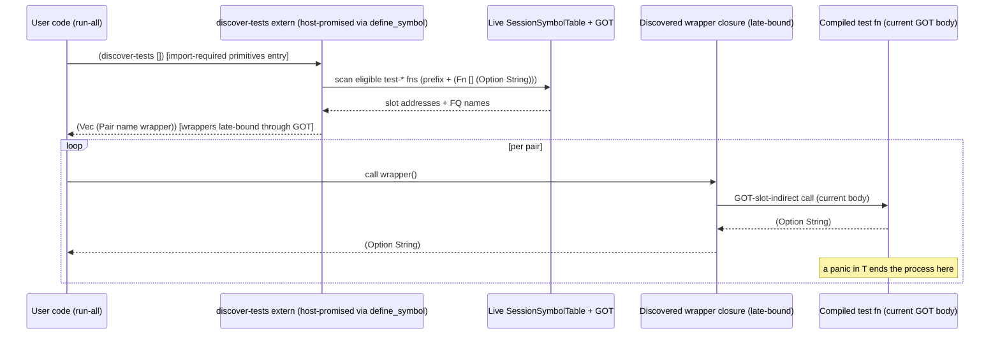

# Test discovery and the compiler test runner

**Status.** Owner `arch`. An adopted, landed contract. The language surface
(§§1, 3–7) was settled by the user on 2026-06-06 and implemented S76–S77. The
compiler test runner and the batch refusal of `discover-tests` were
user-approved and implemented in S122 (`src/session_v4/test_runner/`). S123 W1
made every runtime panic end its process: it removed `catch-runtime-error`, the
thread-local error slot and the fork-join error ferry, and split the compiler
runner into a supervisor and a test child (user rulings, 2026-11-15).
Companion: [execution tracing](tracing.md). Interior of the runner:
[`--test` and the shared test runner](../int/test-runner.md). Normative surface:
`spec/appendix-a-builtins.md` §A.3, `spec/03-types.md` (`Pair`),
`spec/12-runtime.md` §12.7, `repl/spec/16-test-discovery.md`,
`repl/spec/00-cli-invocation.md` §0.2.2.

## 1. Overview

Test discovery lets a Cranelisp program find the tests in a module from inside
the language and run any of them, so that selection, execution and presentation
compose as ordinary user code. A test is nothing special: a zero-argument
function whose name begins `test-` and whose type is exactly
`(Fn [] (Option String))` — `None` = pass, `Some reason` = fail.

The language surface is one `primitives`-module entry, `discover-tests`, plus
the existing macro system. It parses as plain `Expr::Apply`, types by ordinary
scheme resolution and requires import or FQ reference like any other
`primitives` name — zero frontend and zero typecheck special-casing. It returns
the eligible tests of the named modules as
`(Vec (Pair String (Fn [] (Option String))))`: pairs of fully-qualified name
and a **late-bound callable** that performs a GOT-slot-indirect call, so a
redefined test runs its current body and a fresh call sees the current test
set. It is available only in the REPL.

Everything a program builds over it — selection, filtering, iteration, result
interpretation, reporting, timing via `trace` — is in-language code, such as
the stdlib's `stdlib/testing/runner.cl`.

Separately, the compiler owns **one test runner**. `/run-tests`,
`/run-all-tests` and `--test` are argument adapters to it
(`repl/spec/16-test-discovery.md` §16.2). It does not use the primitive or any
library code, and it is the only place a panicking test is isolated.

**A panic ends the process that raised it** (`spec/12-runtime.md` §12.7.2;
[bounded contexts](bounded-contexts.md) §4b invariant 13). No language
construct catches one; a program avoids a panic with a checked operation that
returns `Option`, such as `checked-quot`.

## 2. Settled rulings

The user's rulings, recorded as decided. Each carries the reason a competent
contributor would otherwise be tempted to undo it.

- **Return shape — fn-value pairs, not names (ruling 1, composability).** A
  helper that wraps discovery and returns names freezes the test set at the
  helper's own expansion or compile time; every composition over it inherits
  the frozen set. Freshness must live in the returned **values**: each callable
  is a closure over a GOT slot, late-bound, and each `discover-tests` call
  rescans. A names-only return with a stdlib macro doing name→call was built and
  overturned on exactly this ground. Do not reintroduce it.
- **`run-test` — subsumed.** Running a test is invoking a discovered callable.
  No separate invoke-by-name primitive.
- **No protected call** (S123). `catch-runtime-error` existed only because a
  panic used to return to its caller. Panics now end the process, so the
  combinator has no outcome to report and is removed. Reintroducing a catch
  needs unwind tables for JIT frames and reopens the S123 panic ruling, which
  needs the user.
- **Scope — an empty vector means the session's current module.** All-modules running is the
  `/run-all-tests` case or an explicit module list.
- **One extern taking `(Vec String)`.** Calls pass the vector:
  `(discover-tests [])` for the session's current module,
  `(discover-tests ["user.math"])` for a named module. There is no
  no-argument or single-`String` shape of the primitive and no overloads: the
  multi-signature machinery serves typed in-language bodies monomorphised per
  call site; a host-promised extern with one body and one return type does not
  fit (Principle 6). `stdlib/testing/runner.cl` provides the optional variadic
  `discover-here` macro: its no-argument form emits
  `(primitives/discover-tests [])`; named arguments become a vector of paths.
  The empty vector means the session's current module, not the caller's
  lexical module, and discovery does not extend scope through imports; see
  [REPL module scope](../../repl/spec/16-test-discovery.md#163-the-primitives-uncovered-s122).
- **Eligibility — prefix AND exact signature.** A `test-*` fn contributes a pair
  only if its scheme is exactly `(Fn [] (Option String))`. A mis-typed `test-*`
  is excluded, and warned at discovery time, so a silently skipped test cannot
  read as "no failures". Rejected: refusing at `defn` (a legitimately non-test
  `test-`-prefixed helper would error) and widening the return type.
- **Visibility — binary.** The entry is an ordinary `primitives` name:
  import-required or FQ, shadowable, not reserved. Whether the prelude
  re-exports it is a stdlib packaging choice.
- **Discovery is REPL-only.** `discover-tests` needs a live dev session, so a
  program that references it is refused under `--run`, `--link`, `--test` and
  inside a test child (§4.5). Under `--test` the compiler runner discovers the
  tests; test code does not. Making `discover-tests` available outside the
  REPL, by a stub, an elision or installed runner state, reopens a settled
  ruling and needs the user.

### Explicit test harness — the compiler runner

The requirements are [CLI invocation](../../repl/spec/00-cli-invocation.md)
§0.2.2 and [test discovery](../../repl/spec/16-test-discovery.md) §16.2 and
§16.6. The interior, including its module map and the test child, is
[`--test` and the shared test runner](../int/test-runner.md).
[ACT-0988](../../sprints/actions/ACT-0988-project-regression-discovery.md)
retains only the deferred scope: configurable selection, discovery beyond the
import chain, and option-controlled failure diagnostics.

- **One runner; the modes are argument adapters.** `/run-tests`,
  `/run-all-tests` and `--test` supply a module selection to one runner and
  otherwise behave identically. Eligibility, warnings, execution, the report
  (including the empty-run `No tests found`) and failure handling are the same
  code ([Principle 7](principles/07-single-source-of-truth.md)): the REPL
  commands and `--test` reach the same supervisor and child, and that runner
  and the `discover-tests` extern list tests through the one scan,
  `discovery::scan_modules`. Only the host's use of the result differs: the
  CLI writes the report to stdout, writes warnings to stderr and exits with the
  report's status; the REPL displays both and continues. A mode-specific
  message, report or failure policy is a defect.
- **One child, restarted after a panic** (user ruling). The supervisor runs in
  the client's process and never compiles or runs a test. A child of the same
  binary compiles the selection and runs the tests, streaming one record per
  test. A panicking test ends the child; the supervisor reports that test as
  `PANIC: <message>` and restarts the child after it
  ([test runner §6.5](../int/test-runner.md#65-the-test-child)).
- **The supervisor classifies an ending by the terminator's published
  constants**, the report prefix and the exit status, so the producer and the
  consumer share one copy.
- **Selection is the only input that varies.** `/run-tests` selects the current
  or named module and `/run-all-tests` every loaded module that is not a
  library module ([test runner §4.1](../int/test-runner.md#41-classifier)). `--test`
  selects the entry module's import chain over published symbol tables, and
  traversal stops at library modules (§0.2.2).
- **Binary-only.** Selection, running and reporting stay in the root crate.
  The binary target reaches the runner through the user-approved supervisor
  entry `supervise_tests`, which needs no session and returns the
  `TestRunReport` with its `text`, `warnings` and `exit_code` accessors; the
  child's engine is `CompilerSession::run_tests`. The report carries the
  verdict, so the binary applies no policy of its own. The child's arguments
  are a CLI surface `spec` states; the record format, the eligibility scan and
  the runner core stay crate-private. No library crate, cache schema, ABI or
  `public-api.txt` baseline is involved.
- **One compile path.** The child compiles exactly as `--run` does
  ([Principle 11](principles/11-single-pipeline-mode-parameters.md)), in the
  same batch run mode (there is no `RunMode::Test`). Only the post-compile
  driver differs: it runs the tests where `--run` calls `trampoline`. `main` is
  neither required nor called; its shape checks sit at the `--run` and
  `--link` driver seams, not in compilation.
- **One refusal across the batch modes.** Each batch driver seam, the test
  child included, applies the one existing compiled-reference detector before
  anything runs or is written (§4.5). The REPL enters through none of them, so
  the refusal needs no mode test.
- **Library classification comes from resolution.** Classify a module by the
  search tier that resolved its file
  ([Principle 24](principles/24-resolve-once.md)), not by a path prefix: the
  default library directory `{project_root}/stdlib/` lies inside the project
  root. `SelectionInputs::classify` compares the recorded file with the
  resolver's own `pipeline::project_root_candidate`.
- **The exact scheme is a soundness condition.** The runner reads a test's
  return word as an `(Option String)`, so a `test-` function returning any
  other type would be misread. Do not relax the predicate to the prefix.

## 3. The requirement

- **Tests are ordinary functions** (`repl/spec/16-test-discovery.md` §16.1):
  no registration construct, no module restriction, only the prefix and the
  exact signature.
- **Composition belongs in the language** (`repl/spec/16-test-discovery.md` §16.5): discovering,
  selecting, running and presenting are expressible as user code, and a
  composition stays aware of tests defined after its helpers were written —
  which is why discovery returns late-bound callables.
- **Runtime observation instead of a `super` import.** In the REPL,
  `spec/08-modules.md` §8 directs test submodules that would need their
  parent's symbols to `discover-tests`, which observes the parent's symbol
  table at runtime through the live GOT, so no parent↔child import cycle is
  constructed. Under `--test` the compiler runner selects the parent's tests
  itself.
- **Minimal language surface, maximal in-language composition.** The language
  owes nothing beyond the one entry. Every richer concept — a `TestCase`
  carrier, tallies, progress dots, timing, substring selection — is stdlib code
  over it. The compiler's own runner (§2) is a host facility, not language
  surface.

## 4. The user experience

### 4.1 Defining tests

```clojure
(defn test-add []
  (if (= (+ 1 2) 3) None (Some "addition broke")))

(defn test-quot-by-zero []
  (match (checked-quot 1 0)
    [None     None
     (Some _) (Some "expected no quotient")]))
```

### 4.2 Discovering and running from the REPL

```
user> /run-tests
  user/test-add ........................... ok
  user/test-quot-by-zero .................. ok

2 passed, 0 failed in 2.34ms
```

`/run-tests [module]` runs the current or named module; `/run-all-tests` runs
the loaded project modules; `cranelisp --test` runs the entry module's import
chain and prints the same report (`repl/spec/16-test-discovery.md` §16.2).
A `test-` function excluded for its type produces one warning, shown before the
report. A test that panics is reported as `PANIC: <message>`, and the tests
after it still run.

### 4.3 The in-language runner over discovered pairs

The runnable in-language runner (`run-all`, `run-matching`) is specified once,
in [REPL §16.5](../../repl/spec/16-test-discovery.md#165-programmatic-use);
`stdlib/testing/runner.cl` is the shipped runner. The architecture facts it
rests on:

- The test's own `(Option String)` is the pass/fail outcome.
- Selection is ordinary user code over the pairs; no discovery-side filter
  exists.
- Each callable is late-bound, so a `discover-tests` call evaluated after a new
  `test-*` is defined includes it.
- **No panic isolation** (user ruling). The in-language runner runs every test
  in the calling process, so a panicking test ends that process and the tests
  after it do not run (`spec/12-runtime.md` §12.7.4). Isolation is the compiler
  runner's supervisor ([§2](#explicit-test-harness--the-compiler-runner)). The runner needs no process-launching capability,
  and the binary adds no host extern for it.

### 4.4 Avoiding panics in tests

A test that must observe a failure case uses a checked operation that returns
`Option`, as `test-quot-by-zero` does (`spec/12-runtime.md` §12.7.3). A test
that panics is a failing test: the compiler runner reports it and moves on,
while the in-language runner stops.

### 4.5 What `--run`, `--link` and `--test` users see

A program in which any compiled function references `discover-tests` — by bare
imported name or FQ, called or not — is refused before any code runs or any
artifact is written. The diagnostic names the symbol and a referencing
function, and its remedy is the one `repl/spec/16-test-discovery.md` §16.6
specifies. Detection is
structural: a body reference whose terminal entry is a host-promised
`RustPrimitive` named in `worker::DEV_SESSION_ONLY_EXTERNS`. An import alone
is not a reference (the prelude glob re-exports every primitive), and a user
`mod/discover-tests` definition is not caught.

The one gate is `src/exe.rs::refuse_dev_session_externs`, called by
`trampoline` (`--run`), `link_by_name` (`--link`) and the test child's
engine `run_tests` (`--test`, `/run-tests` and `/run-all-tests`) with one
mode-free diagnostic. Because the REPL's own evaluation enters through none of those
seams, the primitive stays available there.

**History that binds.** The refusal replaced the interim raw `cc`
`undefined reference to discover-tests`. When a S86 repro asserted that the
linked build should resolve the extern and exit 0, `arch` rejected that oracle:
resolving discovery outside the REPL erases the dev-session boundary and needs
a user re-convergence. `--run` and the linked executable must also produce the
same program output (`repl/spec/00-cli-invocation.md` §0.2.1), which is why
both refuse identically rather than `--run` resolving what `--link` cannot.

## 5. The language construct

```
discover-tests :: (Fn [(Vec String)] (Vec (Pair String (Fn [] (Option String)))))
```

One `(Pair name callable)` per eligible test across the named modules, sorted by
name; an empty `Vec` means the session's current module.

- **`name`** — the fully-qualified `"module/test-name"` as a `String`.
- **`callable`** — a `(Fn [] (Option String))` value whose body performs a
  GOT-slot-indirect call to the test. It closes over the slot's **address**,
  not a baked code pointer, so a redefinition the JIT writes into the same slot
  runs through the same wrapper.
- **Eligibility** — `test-` prefix AND scheme exactly `(Fn [] (Option String))`
  (`src/session_v4/test_runner/discovery.rs::is_test_scheme`). The wrapper's own
  type and the eligibility filter are the same contract.
- **`Pair`** is the minimum product the two-field return needs. It is seeded in
  `primitives` by bootstrap (`register_pair_type`); a richer carrier is stdlib
  code.
- **Pure result.** The vector is returned directly, as notionally constant
  introspection. The governing contract and freshness requirement are in
  `repl/spec/16-test-discovery.md` §16.3.
- **Visibility and import.** `(import [primitives [discover-tests]])` or
  `(primitives/discover-tests …)`. It shadows like any imported name; there is
  no reserved-binder enforcement.
- **Untraceable entry.** The entry has no GOT slot, so a call to it has no
  GOT-indirect callee to redirect: structurally untraceable, the same status as
  an inline primitive (spec §4.12.3 exclusion). The callables it returns are
  GOT-indirect and therefore traceable.

**Retired:** `run-test`; `TestResult`/`TestPass`/`TestFail`; `catch-runtime-error`
(S123); reserved-word and keyword-dispatch rows for the test names (`trace`
stays reserved); the raw unresolved-symbol `--link` interim (§4.5).

## 6. The implementation

### One publication kind

`discover-tests` is a slot-less `primitives` callable of origin
`RustPrimitive` with `Life::HostPromised`, keyed by its ABI name
(`src/bootstrap.rs` `register_test_infrastructure`). The backend lowers a call
to it as a `Linkage::Import` against the key (`compiler/apply.rs`, the
host-promised arm). Its body reads the binary's live typed session state (the
per-module `SessionSymbolTable` + GOT) and constructs `Pair` and closure
values. `cranelisp-intrinsics` cannot name `Code` (Principle 18), so the body
lives in the binary and is promised at session init through
`Jit::define_symbol` (`worker::build_session_jit`).

The historical name `DefKind::PrimitiveExtern` in older comments denotes this
same host-promised class; `DefKind` no longer exists.

### The discovery extern

`discover_tests_extern` (`src/session_v4/test_runner.rs`) reads the
`TEST_RUNNER` thread-local state, decodes the `(Vec String)` argument (empty →
current module), lists each module's tests through the shared scan
(`discovery::scan_modules`) and, per test, builds a heap `String` name and a
heap closure `[header | code_ptr=wrapper | drop_glue_ptr=0 | slot-address]`
whose wrapper loads the slot and calls the current body. A null `TEST_RUNNER`
(no eval active) returns an empty `Vec`. The extern runs inside compiled code
and has no warning channel, so it discards the scan's warnings; the slash
commands show them ([test runner §12](../int/test-runner.md#12-residual-leads)).

### `Pair` seeding

`register_pair_type` (`src/bootstrap.rs`, step 4b) seeds `(Pair a b)`, one
2-field data constructor, into `primitives` on the `register_option_type`
pattern. Stdlib may re-export or restate it; that is a packaging choice.

### Frontend — nothing (zero special-casing)

The form parses as plain `Expr::Apply` to an `Expr::Var`. The former
head-position builders and keyword rows for `discover-tests`/`run-test` are
deleted; `trace` keeps its builder. No `Expr` variant, no reserved-word status.

### Typecheck — nothing (zero special-casing)

The callee resolves like any symbol in the `primitives` table. Discovery-driven
entry points are monomorphisation roots like `main` (BC §2 invariant 12).

### Backend — one host-promised call arm; `Jit::define_symbol`

A host-promised callee lowers as a `Linkage::Import` against the entry key,
identical in shape to the platform-effect and intrinsic import paths.

`Jit::define_symbol(name, ptr)` inserts into the map the JIT's
`symbol_lookup_fn` consults at module finalization, so an unresolved
`Linkage::Import` against `name` settles to the promised pointer. It is the one
additive host-symbol escape hatch — no forked constructor, no registry (BC §3
invariant 8).

### Binary — bootstrap, the extern, the runner, the batch refusal gate

`src/bootstrap.rs` seeds the entry and `Pair`; `worker::build_session_jit`
promises each name in `DEV_SESSION_ONLY_EXTERNS` (today `discover-tests`) via
`define_symbol`; `src/exe.rs::refuse_dev_session_externs` is the refusal gate
at the batch driver seams (§4.5). `TestRunnerState` lives on `SharedState` and
serves only the REPL extern; the compiler runner does not install it. The
supervisor and child are `src/session_v4/test_runner/child.rs`; the
`/run-tests` and `/run-all-tests` commands (`src/repl/commands.rs`) select
modules and call the supervisor.

## 7. Data structures, functions & sequence

- `discover-tests`: `primitives` callable, `RustPrimitive` +
  `Life::HostPromised`, scheme `(Fn [(Vec String)] (Vec (Pair String (Fn []
  (Option String)))))`, no slot, key = ABI name, body promised by the binary.
- Bootstrap-seeded ADT in `primitives`: `(Pair a b)`, alongside `Option`.



Freshness lives in the wrapper (late-bound through the live GOT) and in
re-calling `discover-tests` (a rescan) — never in expansion timing.
